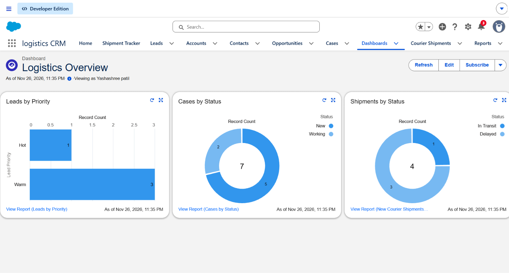
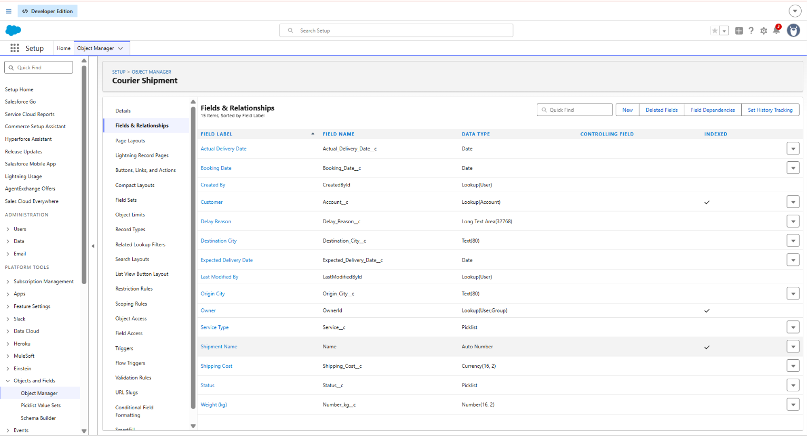
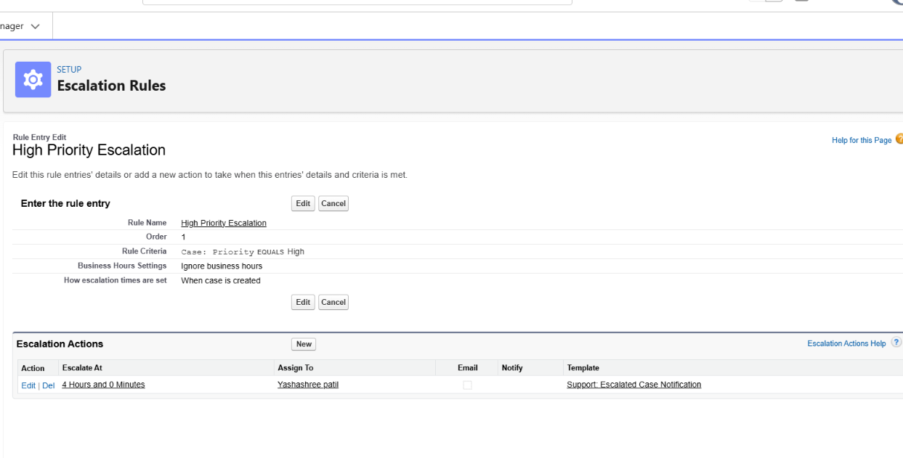
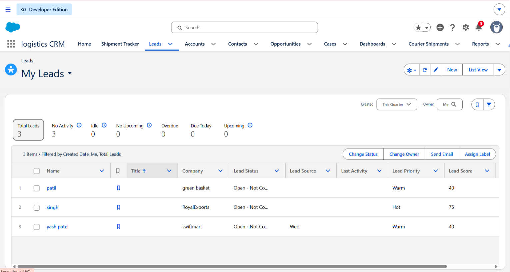
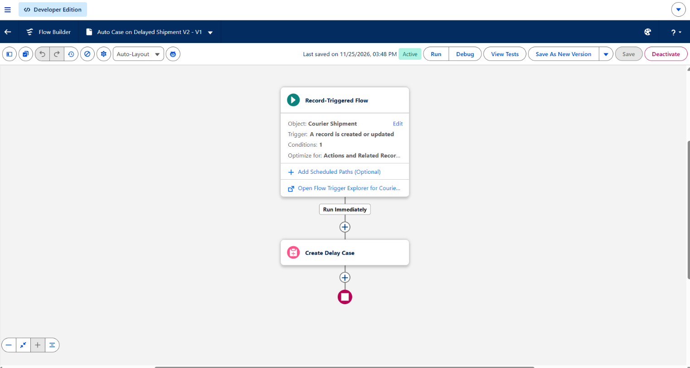
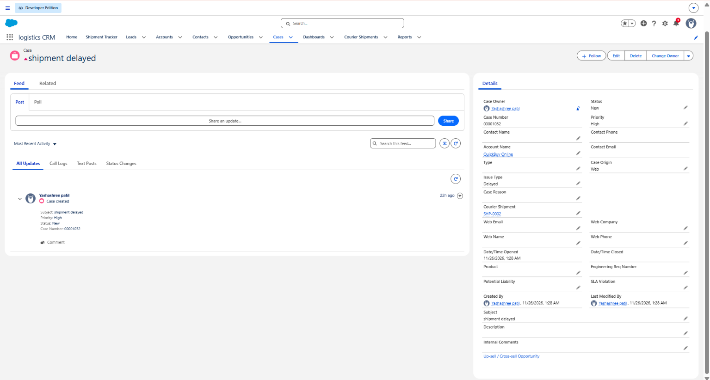
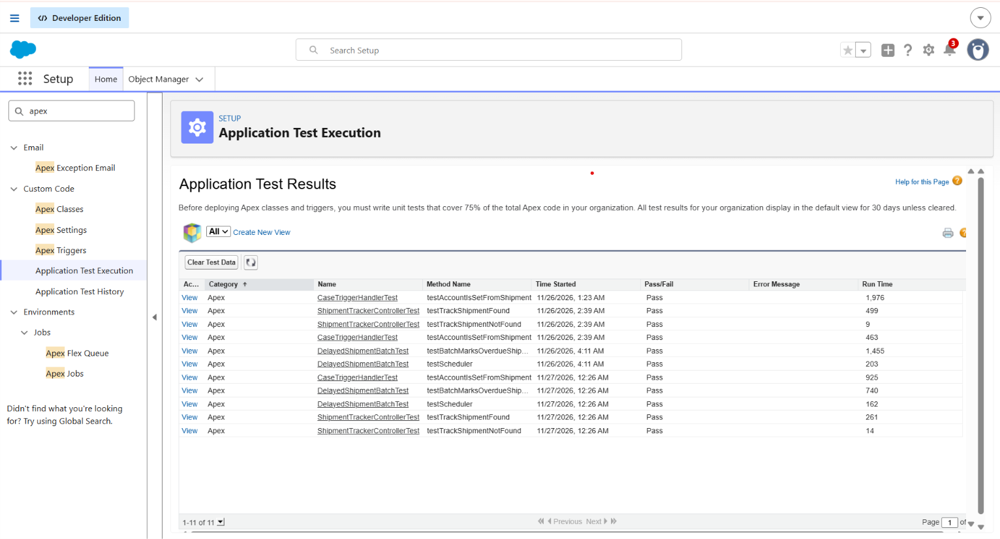
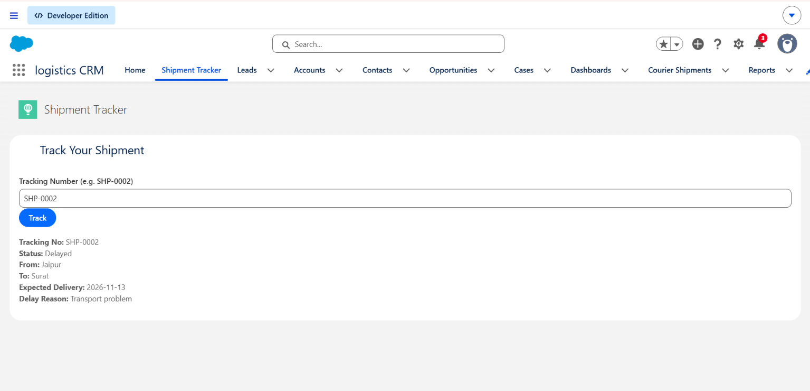
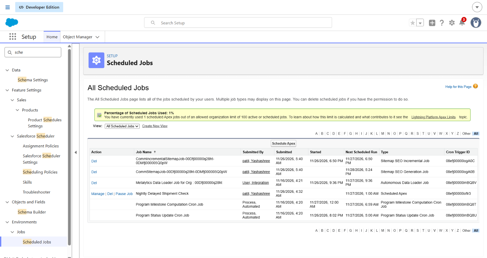
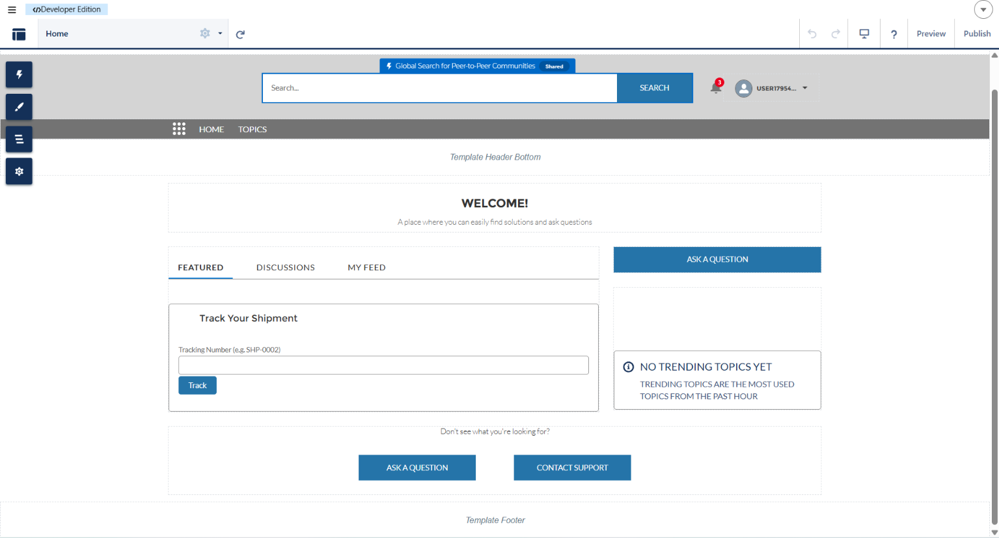

# Logistics CRM on Salesforce

A Salesforce project covering sales (leads) and support (shipment cases) for a logistics company, built with both Admin (declarative) and Developer (code) skills.

## Problem
Logistics companies often track leads and delivery complaints in spreadsheets. This causes slow follow-up, missed delays and no single view of the customer.

## Solution
One Salesforce CRM where leads are scored and assigned automatically, delayed shipments create support cases by themselves, and customers can track a shipment.

## Features

### Sales (Admin)
- Custom lead fields and a **Lead Score** and **Lead Priority** (Hot / Warm / Cold) formula
- Region-based **Lead Assignment Rules**
- Lead conversion to Account, Contact and Opportunity

### Support (Admin)
- Custom **Courier Shipment** object linked to Accounts and Cases
- **Case Assignment Rules** and a **High Priority Escalation Rule** with email
- **Validation rules** for data quality
- **Record-triggered Flow**: when a shipment becomes Delayed, a High priority Case is created

### Developer
- **Apex trigger + handler** (`CaseDelayTrigger`, `CaseTriggerHandler`): copies the Account from the shipment onto the Case
- **Batch + Scheduled Apex**: flags overdue shipments as Delayed
- **Lightning Web Component** `shipmentTracker` with an Apex controller, shown in the app and on an **Experience Cloud** site
- **Test classes** for all Apex, all passing
- **Reports and a dashboard**: leads by priority, cases by status, shipments by status

## How it works
1. A shipment is changed to **Delayed** (a delay reason is required).
2. The **Flow** creates a High priority **Case** linked to the shipment.
3. The **Apex trigger** fills the Account on the Case.
4. The **Escalation rule** reassigns and emails if the case stays open too long.
5. A nightly **Batch job** flags other overdue shipments the same way.

## Tech stack
Salesforce (Sales Cloud, Service Cloud, Experience Cloud), Apex, SOQL, Lightning Web Components, Flow, Reports and Dashboards, GitHub

## Screenshots

**Dashboard**

**Data model**

**Escalation rule**

**Lead score and priority**

**Flow**

**Case with Account filled by Apex**

**Apex tests passing**

**Shipment tracker (LWC)**

**Scheduled job**

**Experience Cloud portal**

## Author
[Your Name] | [LinkedIn link]
